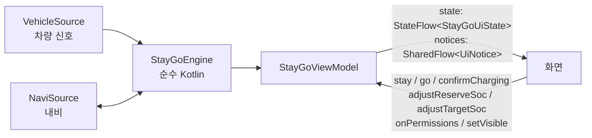

# UI 연동 계약

화면 구현이 지켜야 하는 경계와, 화면이 받는 상태·보낼 수 있는 동작을 정리한 문서다.

## 구조



- 화면은 `StayGoViewModel`만 참조한다. `core`, `decision`, `signal`, `vehicle`, `navi` 패키지의 코드는 화면에서 호출하지 않는다.
- 화면은 앱 상태를 보관하지 않는다. `state`를 그대로 그리고, 조작은 ViewModel 메서드로 넘긴다. 창 크기·방향·주야 전환은 `MainActivity.onConfigurationChanged`가 레이아웃을 다시 펼치고 같은 상태를 다시 그린다.
- 화면은 `MainActivity.kt`, `ui/HeroPresenter.kt`(판정·제목·이유 문구, 순수 함수), `ui/Charts.kt`, `res/layout*`이다.
- `StayGoUiState`에는 표시 문자열이 없다. 문구는 `HeroPresenter`와 `MainActivity`가 정한다.

## 수명주기

- `onStart`에서 `setVisible(true)`, `onStop`에서 `setVisible(false)`를 부른다. 화면이 보이지 않는 동안 ViewModel은 차량·내비 구독과 1초 타이머를 모두 멈춘다. 앱에는 서비스가 없다.
- 충전 세션(충전 확인 시각, 세션 최대 전력, 목표 SOC)은 화면이 가려진 동안 유지되고, 저장 상태(`SavedStateHandle`)로 프로세스 재생성 뒤에도 복원된다. 돌아왔을 때 배터리 잔량이 0.5 kWh 넘게 줄었거나 3시간이 지났으면 새 세션으로 본다.
- 뒤로 가기는 앱을 끝내지 않고 숨긴다(`moveTaskToBack`).
- 권한이 없으면 화면이 먼저 이유를 보이고(`VEHICLE_LINK_UNAVAILABLE`, `PERMISSION_DENIED`), 「권한 허용」을 누를 때 시스템 권한 창을 연다. 시스템이 창을 더 띄우지 않으면 앱 설정 화면을 연다.

## 화면이 받는 값

`StayGoUiState.screen`이 어떤 화면을 그릴지 정한다.

| `screen` | 상황 | 표시 | 가능한 조작 |
|---|---|---|---|
| `DRIVING` | 주행 제한(DO) 상태. 다른 모든 화면보다 우선한다. | 조작 요소를 모두 가리고 요약 한 줄 | 없음 |
| `VEHICLE_LINK_UNAVAILABLE` | 권한 거절, SOC 미지원, 차량 서비스 없음, 주행 제한 상태를 알 수 없음(`vehicleLinkFailure`) | 연동 불가 안내. 차량 값은 표시하지 않는다(`socPercent`가 null). | `PERMISSION_DENIED`일 때 권한 허용 |
| `CONNECTING` | 시작·복귀 후 5초 안, 첫 차량 값 대기 | 확인 중 | 없음 |
| `CHARGING_UNCONFIRMED` | 충전 상태와 배터리 전력량을 모두 읽지 못함 | 충전 상태 확인 불가 | `confirmCharging()` |
| `NOT_CHARGING` | 정차, 충전 아님 | 「충전을 시작하면 판단합니다」 | 없음 |
| `CHARGE_FINISHED` | 충전 완료 또는 충전기 상한 도달 | 충전 종료, 점유 고지(`occupancy`) | `go()` |
| `NO_DESTINATION` | 충전 중, 내비 목적지 없음 | SOC·충전전력만, Go 잠금 | 없음(내비에서 목적지 설정) |
| `TARGET_SOC_NEEDED` | 충전 중, 내비가 도착 예상 SOC를 주지 못함 | 목표 SOC 입력 | `adjustTargetSoc(±5)` |
| `DECISION` | 충전 중, 판단 가능 | Stay·Go 분기 | `stay()`, `go()`, `adjustReserveSoc(±5)`, `adjustTargetSoc(±5)` |

<p>표 1. 화면 종류와 조작.</p>

주행 제한 상태는 플랫폼이 「제한 없음」을 알려 주기 전까지 잠금으로 본다. 알림이 오지 않으면 5초 뒤 `VEHICLE_LINK_UNAVAILABLE`이 되고 Go는 동작하지 않는다.

| 필드 | 뜻 |
|---|---|
| `decision.rule` | 판단 규칙 번호(1~6). 입력을 기다리는 동안은 null |
| `decision.emphasis` | `STAY`, `BOTH_STAY`(둘 다 보이고 Stay 기본 강조), `GO`, `NONE` |
| `power` | 현재 충전전력. `estimated`가 true이면 「추정」 표시가 필요하다. `sessionMaxTrusted`가 false이면 SOC 기준(규칙 6)으로 판단 중이다. |
| `powerHistory` | 세션 충전전력 기록(차트·추세용) |
| `batteryLevelKwh`, `capacityKwh` | SOC 타일의 잔량·용량 |
| `arrival` | 도착 예상. `basis`가 `NAVI_DIRECT`(내비 값), `NAVI_ROUTE_ENERGY`(경유 충전 없이 갈 때의 계산값), `DRIVER_TARGET`(목표 SOC 기준) 중 하나다. `deficitPct`는 부족분, `extraWaitMinutes`는 현재 전력 기준 대기 시간의 하한이다. |
| `route` | `None`, `Direct`, `ViaStop`(경유지 이름, 경유지 도착 SOC, 최대 출력, 충전기 수, 비교 결과). `outputSource`가 `SNAPSHOT`이면 최대 출력·충전기 수는 앱에 넣어 둔 목록 값이므로 `snapshotAsOf`(기준일)를 함께 표시한다. |
| `go` | `DIRECT`, `VIA_STOP`이면 Go 가능. `LOCKED_*`이면 잠금 사유 |
| `socMismatch` | 차량 표시 SOC와 잔량 기준 SOC가 3%p 넘게 다를 때만 값이 있다. |
| `occupancy` | 앱이 충전을 처음 확인한 뒤 지난 분. `warning`은 50분부터 true. 실제 충전 시작 시각이 아니다. |
| `reserveSocPct`, `manualTargetSoc` | 예비 SOC(기기에 저장), 목표 SOC(세션 한정) |

<p>표 2. 판단 화면의 상태 필드.</p>

`notices`는 한 번만 보여 줄 결과다: `GoRecommended`(충전 세션당 한 번), `RouteSent`, `RouteFailed`, `StayAcknowledged`, `DestinationRequired`, `NaviUnavailable`.

## 화면이 지켜야 하는 규칙

- `screen == DRIVING`이면 조작 요소를 하나도 남기지 않는다. 알림과 설정 화면도 닫는다.
- `vehicleLinkFailure`가 있으면 SOC·전력 등 차량 값을 그리지 않는다. 이전 값이 남아 보이면 안 된다.
- `power.estimated`, `arrival.basis`, `comparison.expectedPowerEstimated`, `route.outputSource`가 뜻하는 「추정」·「계산값」·「자료 기준일」 구분을 화면에서 지우지 않는다.
- 경유 충전 비교를 보일 때는 대기·고장 여부를 알 수 없다는 문구를 같은 화면에 둔다. 경유 충전이 더 빠르다고 계산되어도 Go를 단독 권장으로 강조하지 않는다.
- 대기 시간은 현재 전력이 유지된다고 본 하한이므로 「최소」로 적는다.
- 「80% 의무」처럼 법령에 없는 표현, 시간 단축을 보장하는 표현은 쓰지 않는다.
- 모든 창 크기에서 같은 조작이 가능해야 한다. 좁은 창에서 요소를 숨길 때는 조작이 아니라 보조 표시를 숨긴다.
- 1초마다 같은 상태가 다시 그려진다. 값이 바뀌지 않은 뷰는 다시 설정하지 않는다(`MainActivity.text`, `styleButton`, `setPill`).

## 시뮬레이터로 화면 개발

Pleos Connect 에뮬레이터 없이도 디버그 빌드의 시뮬레이터로 일반 Android 에뮬레이터나 기기에서 화면 작업을 할 수 있다. 시뮬레이터는 디버그 빌드에만 들어 있고 release APK에는 없다. 디버그 빌드는 StrictMode 위반을 로그(`StrictMode` 태그)로 남긴다.

```bash
./gradlew :app:installDebug
adb shell am start -S -n ai.staygo.app/ai.staygo.MainActivity --es sim charge --ei speed 10
```

런처의 「스테이고 시뮬레이터」 항목은 `charge` 시나리오를 1배속으로 연다. `speed`는 1~20이다. 시나리오를 바꿀 때는 `-S`(강제 종료 후 시작)를 붙인다.

| `sim` 값 | 재현하는 상태 |
|---|---|
| `charge` | 시연 충전 곡선. 규칙 2(Stay) → 3(둘 다) → 4(Go). Go를 누르면 8초 뒤 주행 화면 |
| `real` | 같은 곡선에 충전 상태·순간 충전전력 신호가 오는 경우(「추정」 없음) |
| `via` | 50 kW 충전기, 30%p 부족, 앞쪽 200 kW 경유지: 규칙 5 비교와 경유 Go |
| `late` | 출력 감소 구간에서 앱을 연 경우: 규칙 6 |
| `nodest` | 목적지 없음 |
| `navidown` | 내비 연결 실패: 목표 SOC 입력 |
| `tripfail` | 도착 예상 SOC 무응답: 목표 SOC 입력 |
| `unsupported` | SOC 미지원 |
| `denied` | 권한 거절 |
| `nosignal` | 충전 상태 확인 불가: 운전자 확인 |
| `finish` | 충전기가 80%에서 종료 |
| `idle` | 충전 아님 |
| `mismatch` | 차량 표시 SOC와 잔량 기준 SOC의 차이 |

<p>표 3. 시뮬레이터 시나리오.</p>

창 크기는 `adb shell wm size`·`wm density 160`으로 Pleos 창 규격(1682×1210, 1280×1210, 1040×850, 840×1184 dp)에 맞춰 확인한다. 시나리오의 신호 동작은 Pleos Connect v2.1.0 에뮬레이터 실측(충전 상태 2 고정, 순간 충전전력 0, 잔량 1 Hz, 직행 도착 SOC 10% 미만에서 경유지 삽입)을 따른다. 시뮬레이터는 화면 개발과 회귀 시험용이며, 출시 점검은 Pleos Connect 에뮬레이터에서 `tools/pleos_checks.sh`로 한다.
